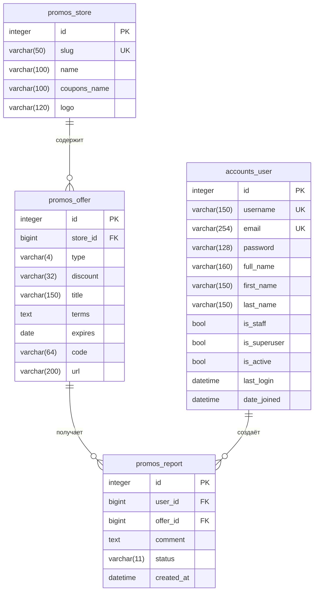

# ER-диаграмма каталога и обращений

- Еmail уникален независимо от регистра. `password` хранит хеш Django. Активный пользователь с `is_staff = true` имеет роль ADMIN. Доступ к списку обращений в Django Admin дополнительно определяется разрешениями модели.
- У каждого обращения ровно один автор и одно предложение. Пользовательский интерфейс выбирает обращения по `user_id` текущего пользователя. Статусы в базе: `new`, `in_progress`, `done`.
- Нельзя удалить предложение, пока к нему привязаны обращения. В промокоде заполнен `code`, в акции заполнен `url`.
- [SQL-схема](schema.sql) показывает четыре таблицы предметной области. Миграции Django дополнительно создают таблицы групп, разрешений, журнала администрирования и сессий.
