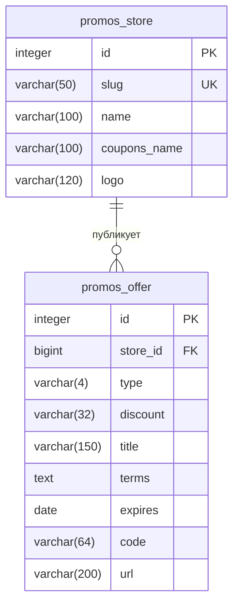

# ER-диаграмма каталога

У магазина может быть несколько предложений или ни одного. У каждого предложения ровно один магазин. Внешний ключ `store_id` ссылается на `promos_store.id` и индексируется. Django защищает магазин от удаления, пока с ним связаны предложения.

У промокода `type = code` заполнено поле `code`, а у акции `type = link` заполнено поле `url`. Второе поле содержит пустую строку. Это правило проверяют и серверная форма, и ограничение `offer_code_or_link` в SQLite.

[SQL-схема каталога](schema.sql) сгенерирована из миграции `promos.0001_initial`. Django создаёт собственные служебные таблицы и модель пользователя отдельными миграциями.
